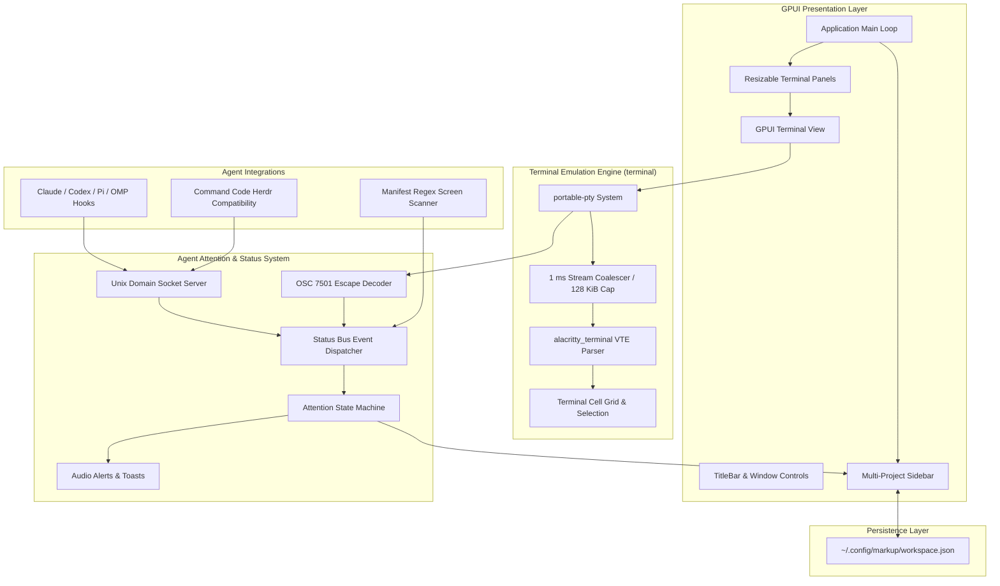
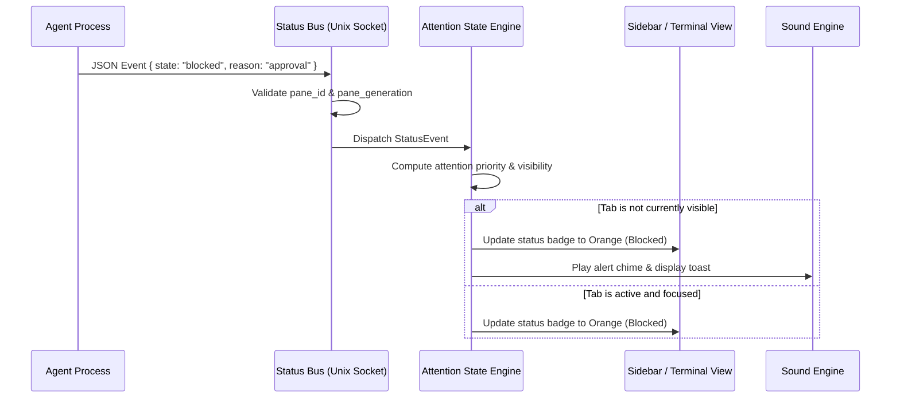

# Markup Architecture

This document describes the architectural design, core subsystems, and data flows of the **Markup** terminal emulator.

---

## 1. System Overview

Markup is designed around three primary concerns:
1. **High-throughput, GPU-accelerated terminal emulation** using GPUI and Alacritty's VTE parser.
2. **Autonomous AI agent state tracking** via an IPC status bus and the Herdr attention protocol.
3. **Multi-project workspace management** with persistent project-scoped terminal sessions.

---

## 2. Core Subsystems

### 2.1 Terminal Emulation (`terminal`)

The terminal widget is implemented in the `terminal` sub-crate:
- **PTY Management**: Spawns user shells using `portable-pty` with asynchronous read and write loops.
- **Throughput Protection**: Uncontrolled terminal streams (e.g., fast compiler output or large file dumps) can overwhelm desktop UI threads. Markup employs an adaptive **1 ms stream coalescer** and a **128 KiB parse cap per frame**. This ensures UI responsiveness even at stream rates exceeding 40 MB/s.
- **Rendering**: Terminal glyphs and styling (bold, italic, 24-bit RGB true color) are painted directly via GPUI primitives using embedded monospace fonts (`Mononoki`).

### 2.2 Status Bus & IPC (`src/status_bus.rs`, `src/status.rs`)

The status bus receives events from running agent processes:
- **Unix Domain Socket**: Markup binds a private per-user Unix socket at `$XDG_RUNTIME_DIR/markup-status.sock` (or `/tmp/markup-$UID/status.sock`).
- **Generation Authentication**: Each terminal pane receives a unique `pane_generation` token in its environment (`MARKUP_PANE_GENERATION`). The status bus verifies this token to reject stale or unauthorized events from old processes.
- **OSC 7501 Fallback**: For environments where local sockets cannot be bridged, agents can emit custom OSC 7501 ANSI sequences directly to stdout (`\x1b]7501;state=working...\x1b\`).

### 2.3 Agent Attention Model (`src/attention.rs`)

Markup implements the Herdr agent attention model to eliminate notification fatigue while guaranteeing critical tasks are never missed:
- **Attention Hierarchy**:
  $$\text{Blocked} > \text{Done} > \text{Working} > \text{Idle}$$
  - `Error` ranks as `Blocked`.
  - `Unknown` and `Active` rank as `Idle`.
- **Unviewed Completion Latching**:
  - When an agent finishes while focused and visible, its status transitions directly to `idle`/`active` without ringing bells.
  - When an agent finishes while unfocused or in a hidden tab, its status latches to `done`. An audio alert plays and a notification toast appears. Switching to that tab automatically clears the status to `idle`.
- **Sub-Agent / Worker Hierarchy**: Child sessions (reporting an `agent_id`) are grouped under their parent session without raising independent notifications or corrupting the parent's status.

### 2.4 Agent Integrations (`src/integrations.rs`, `src/agent_rules.rs`)

Markup provides automated one-command setup for developer agent ecosystems:
- **Claude Code**: Hooks registered into `~/.claude/settings.json`.
- **Codex**: Hooks registered into `~/.codex/hooks.json`.
- **Pi & OMP**: Extension modules placed into dedicated agent directories.
- **OpenCode**: Upstream V2 TUI session listener plugin (`assets/integrations/opencode-tui.js`).
- **Command Code**: Direct native compatibility via Herdr socket environment variables (`HERDR_SOCKET_PATH`, `HERDR_PANE_ID`).
- **Screen Detection**: Embedded TOML manifests (`assets/agent-detection/*.toml`) evaluate regex patterns on visible terminal screen buffers to detect agent activity without requiring agent configuration.

### 2.5 Workspace State & Persistence (`src/workspace_state.rs`)

- Open projects, active directories, and terminal session metadata are serialized to JSON in `~/.config/markup/workspace.json`.
- On startup, Markup reads the workspace state and seamlessly restores the project sidebar tree and terminal panes.

---

## 3. Data Flow: Agent Event to UI Update

