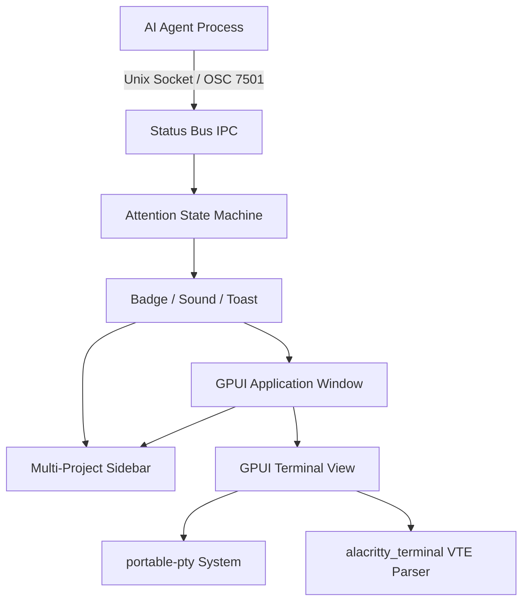

# Markup

> A GPU-accelerated terminal emulator built for developers orchestrating AI coding agents across multiple projects.

Markup combines ultra-fast native terminal rendering powered by [GPUI](https://gpui.rs) and [alacritty_terminal](https://github.com/alacritty/alacritty) with an intelligent **Agent Attention Model** and multi-project workspace management. It tracks the state of autonomous AI agents (Claude Code, OpenCode, Codex, Pi, OMP, Command Code) in real time—alerting you when an agent is blocked, waiting for input, or finished while you were away.

---

## Key Features

- **🚀 GPU-Accelerated Terminal Rendering**
  - Powered by GPUI and Alacritty's VTE engine for 60+ FPS, tearing-free rendering with minimal latency.
  - Adaptive 1 ms stream coalescing with a 128 KiB parse cap handles intensive outputs (e.g., 40 MB/s compilation logs) without locking the UI thread.
  - Full support for ANSI colors (16 standard, 256-color, 24-bit true color), bold, italics, underlines, and custom font glyphs.

- **🤖 Native Agent Attention System**
  - **Herdr Protocol Parity**: Strict attention priority hierarchy (`blocked > done > working > idle`).
  - **Unviewed Completion Latching**: If an agent finishes while its tab is not visible or the window is unfocused, it latches to `done` and alerts you. When you switch to it, it transitions cleanly to `idle`.
  - **Audio & Visual Notifications**: Dedicated audio chimes and system toasts for blocked queries and unobserved completions (`MARKUP_NO_SOUND=1` supported).
  - **Sub-Agent / Worker Hierarchy**: Child sessions indented cleanly beneath parent agents without triggering duplicate alerts.

- **📁 Multi-Project Sidebar & Session Persistence**
  - Group terminal sessions cleanly under collapsible project folders in the sidebar.
  - Workspace state automatically persists to disk and restores your open projects and sessions across restarts.
  - Quick-action buttons to create new terminal sessions per project or open existing directories.

- **🔌 First-Class Agent Integrations & CLI**
  - Automated one-command setup for popular agent CLIs:
    ```bash
    markup integration setup
    ```
  - Built-in hook support for **Claude Code**, **OpenCode v2**, **Codex**, **Pi**, **OMP**, and **Command Code** (native Herdr compatibility).
  - Explicit CLI reporting via `markup report <state> [message]` or standard OSC 7501 escape sequences.

- **🖥️ Desktop Polish**
  - Native window decorations and custom title bar controls.
  - Bundled custom application icons for Linux (`.desktop` auto-registration), macOS, and Windows.
  - Pre-configured GitHub Dark theme palette with embedded Mononoki monospace fonts.

---

## Architecture Overview



---

## Installation & Building

### Prerequisites

- **Rust**: Version 1.85+ (Edition 2024 support)
- **Linux Packages**:
  ```bash
  sudo apt install -y libwayland-dev libxkbcommon-dev libfontconfig1-dev libssl-dev cmake pkg-config
  ```
- **macOS**: Xcode Command Line Tools.

### Build from Source

```bash
# Clone the repository
git clone https://github.com/olovalabs/markup.git
cd markup

# Build release binary
cargo build --release

# Run Markup
./target/release/markup
```

---

## CLI Usage Reference

Markup acts both as a standalone GUI terminal and as a command-line helper for running shell sessions and agent scripts:

### Status Reporting

Report agent state from inside any terminal pane:

```bash
# Report active task
markup report working "Refactoring authentication module" --progress 35

# Request user decision or approval
markup report blocked "Waiting for API credentials" --kind auth

# Mark task completion
markup report done "All tests passed"

# Signal an error
markup report error "Compilation failed on status.rs"

# Clear status
markup report clear
```

### Agent Integrations Management

Configure agent CLI hooks automatically:

```bash
# Register hooks for Claude Code, Codex, Pi, OMP, and OpenCode
markup integration setup

# Inspect integration status across installed agents
markup integration status

# Run diagnostic verification
markup integration doctor

# Remove Markup integration hooks cleanly
markup integration remove
```

### Manual Status Inspection

```bash
# Query active terminal status
markup status

# Explain current state inference and detection evidence in JSON
markup status explain --json

# Clear current pane status
markup status clear
```

---

## Testing & Verification

Run the comprehensive test suites:

```bash
# Run core test suite
cargo test

# Run terminal emulator component tests
cargo test -p terminal

# Run OpenCode TUI integration tests (requires bun)
bun test tests/integrations/opencode-tui.test.ts

# Interactive terminal status demo script
./scripts/status-demo.sh working
./scripts/status-demo.sh blocked
./scripts/status-demo.sh done
```

---

## Repository Structure

```
markup/
├── assets/             # Icons, sounds, themes, embedded agent rule manifests
├── components/         # GPUI UI component library (fork of gpui-component)
├── terminal/           # GPU-accelerated terminal emulator widget
├── scripts/            # Development and demo utility scripts
├── src/                # Core application source
│   ├── attention.rs    # Agent attention state machine & priority ladder
│   ├── cli.rs          # CLI parser and command handlers
│   ├── integrations.rs # Automated agent hook configuration
│   ├── main.rs         # Application entry point, window & view layout
│   ├── status.rs       # Agent status schemas & state definitions
│   ├── status_bus.rs   # Unix domain socket IPC bus
│   └── workspace_state.rs # Workspace persistence & session restoration
└── tests/              # End-to-end and integration tests
```

---

## Contributing

We welcome community contributions! Please read [CONTRIBUTING.md](CONTRIBUTING.md) for environment setup and contribution guidelines.

---

## License

Dual-licensed under either:

- **MIT License** ([LICENSE-MIT](LICENSE-MIT) or <https://opensource.org/licenses/MIT>)
- **Apache License, Version 2.0** ([LICENSE-APACHE](LICENSE-APACHE) or <https://www.apache.org/licenses/LICENSE-2.0>)

at your option.
